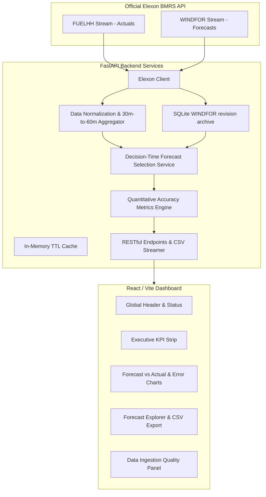

# WindScope UK — Wind Forecast Intelligence

> **"See the latest available wind forecast. Measure its accuracy. Make better-informed procurement decisions."**

WindScope UK is a decision-support dashboard for UK electricity procurement teams. It compares national wind forecasts with subsequently realized generation and calculates forecast-error metrics for a configurable historical period. It selects the latest eligible forecast from the revisions returned by Elexon and previously captured by this application; it cannot prove that the source returned every historical revision.

---

## 1. Project Overview

UK electricity procurement teams must account for changing generation when planning purchases. WindScope UK provides historical forecast and actual-generation comparisons to inform analysis; it does not calculate a procurement position, market price, imbalance cost, or financial outcome.

### Core Capabilities
* **Cutoff-based Forecast Selection:** Selects the latest captured or currently returned WINDFOR revision whose publication timestamp is at or before the configured cutoff.
* **Quantitative Accuracy Metrics:** Calculates MAE, RMSE, MBE, and MAPE on finite matched forecast/actual pairs; zero actuals are omitted from MAPE.
* **Forecast and Actual Comparison:** Displays hourly forecasts, hourly averages of half-hourly actuals, signed errors, error distributions, and UTC-hour summaries.
* **Forecast Explorer and CSV:** Filters, searches, sorts, and paginates evaluation records and exports filtered records.
* **Data-quality and methodology views:** Surfaces missing or excluded observations and explains the analytical assumptions and limitations.
* **Refresh and status feedback:** Refreshes source data and reports loading, empty, and error states.

---

## 2. Features

* **Overview KPIs and charts:** Latest matched observation, aggregate error metrics, hourly forecast/actual series, and signed errors.
* **Forecast Explorer:** Searchable, sortable, paginated records, date/cutoff filters, availability status, and CSV export.
* **Accuracy Analysis:** Error distribution, daily metrics, and UTC-hour metrics.
* **Data Quality and Methodology:** Source and exclusion counts, assumptions, and interpretation limits.

---

## 3. Technology Stack

* **Frontend:** React 19, TypeScript 6, Vite 8, Tailwind CSS v4, Recharts, Lucide Icons.
* **Backend:** Python; FastAPI, Pydantic v2, Pandas, NumPy, HTTPX, Pytest. A clean CPython 3.14 environment passed the backend suite; Docker is configured to use Python 3.11.
* **Storage:** SQLite archive for retrieved WINDFOR revisions; process-local TTL response cache.
* **Containerization:** Multi-stage Docker, Docker Compose, Uvicorn ASGI.
* **Data Source:** Elexon BMRS API (`FUELHH` actuals and `WINDFOR` forecasts).

---

## 4. Architecture



---

## 5. Repository Structure

```text
windscope-uk/
├── backend/
│   ├── app/
│   │   ├── api/
│   │   │   └── routes.py             # /api endpoints, filters, cache, and CSV
│   │   ├── services/
│   │   │   ├── elexon_client.py       # Elexon API connector with bounded retries
│   │   │   ├── forecast_archive.py    # Persistent SQLite archive for WINDFOR revisions
│   │   │   ├── data_normalization.py  # UTC normalization, deduplication, 30m->60m aggregation
│   │   │   ├── forecast_selection.py  # Decision-cutoff forecast selector
│   │   │   ├── accuracy_metrics.py    # MAE, RMSE, MBE, MAPE, diurnal engines
│   │   │   └── data_quality.py        # Provenance & ingestion audit counters
│   │   ├── schemas/
│   │   │   └── models.py              # Pydantic request & response models
│   │   ├── config.py                  # Settings loaded from environment variables
│   │   └── main.py                    # FastAPI entrypoint & frontend static server
│   ├── tests/
│   │   ├── test_accuracy_metrics.py   # Acceptance tests D-I, zero-actual MAPE isolation
│   │   ├── test_forecast_selection.py # Selection logic & cutoff enforcement tests
│   │   ├── test_data_normalization.py # Deduplication & aggregation tests
│   │   ├── test_forecast_archive.py   # Archive persistence and query behavior
│   │   ├── test_elexon_client.py      # HTTP retry and response validation
│   │   └── test_api.py                # Endpoint contracts, CORS, and export validation
│   └── requirements.txt               # Backend dependencies
├── frontend/
│   ├── src/
│   │   ├── api/client.ts              # Typed HTTP fetch wrappers
│   │   ├── components/                # Modular UI components (Charts, Tables, Panels)
│   │   ├── types/index.ts             # Shared TypeScript data interfaces
│   │   ├── App.tsx                    # Main analytics dashboard shell
│   │   └── main.tsx                   # React root entrypoint
│   ├── package.json
│   ├── tsconfig.json
│   └── vite.config.ts
├── docs/
│   ├── assignment-completion-audit.md
│   ├── documentation-audit-report.md
│   ├── architecture.md
│   ├── methodology.md
│   ├── client-presentation.md         # Client-facing product summary and demo script
│   └── technical-walkthrough.md       # Architecture defense & review answers
├── Dockerfile                         # Lean multi-stage build container
├── docker-compose.yml                 # Single-command orchestration
├── .env.example                       # Environment configuration template
├── .gitignore
├── LICENSE                            # MIT License
└── README.md
```

---

## 6. Data Sources

WindScope UK strictly utilizes only the two official, public Elexon BMRS streaming datasets:

1. **Actual Wind Generation (`FUELHH`):**  
   Official API Docs: [Elexon FUELHH Stream](https://bmrs.elexon.co.uk/api-documentation/endpoint/datasets/FUELHH/stream)  
   * Filters: `fuelType = "WIND"`  
   * Fields: `startTime`, `publishTime`, `generation` (MW), `settlementPeriod` (1–48).  
   * Resolution: 30-minute settlement periods. Two consecutive half-hourly periods are averaged into an hourly equivalent actual.
2. **Forecasted Wind Generation (`WINDFOR`):**  
   Official API Docs: [Elexon WINDFOR Stream](https://bmrs.elexon.co.uk/api-documentation/endpoint/datasets/WINDFOR/stream)  
   * Fields: `startTime` (target generation hour), `publishTime` (forecast broadcast timestamp), `generation` (forecasted MW).  
   * Resolution: Hourly (60-minute blocks). Publication-time queries return revision records in the requested window; long-term source retention is not guaranteed.

---

## 7. Forecast Selection and Evaluation Assumptions

The evaluation covers target hours from January 1 through January 31, 2026 by default. The default cutoff is 09:00 UTC on the preceding target date. This is an analytical configuration, not a claim about a contractual procurement deadline.

For a target hour `T` and cutoff `D`, the application selects the latest revision among records actually received from Elexon or saved in its local archive for which `publishTime <= D`. Revisions after `D` are ineligible. Missing forecasts and actuals remain unavailable rather than being filled with zero. This rule prevents selecting a known post-cutoff record, but does not prove that Elexon supplied a complete historical revision set.

Every successfully retrieved WINDFOR record is stored in SQLite. The archive starts when a period is first retrieved; it cannot recover revisions that were already absent at first capture. Evaluation requests still require successful responses from Elexon's endpoints; upstream failures are reported rather than served from the archive alone.

---

## 8. Metric Formulations

* **Signed Error:** $e = \text{forecast} - \text{actual}$ (MW). Positive means forecast exceeds actual; negative means forecast is below actual. Procurement or financial consequences depend on information not modeled here.
* **Mean Absolute Error (MAE):** $\text{MAE} = \frac{1}{N} \sum |\text{forecast}_i - \text{actual}_i|$ (MW).
* **Root Mean Squared Error (RMSE):** $\text{RMSE} = \sqrt{\frac{1}{N} \sum (\text{forecast}_i - \text{actual}_i)^2}$ (MW).
* **Mean Bias Error (MBE):** $\text{MBE} = \frac{1}{N} \sum (\text{forecast}_i - \text{actual}_i)$ (MW).
* **Mean Absolute Percentage Error (MAPE):**
  $\text{MAPE} = \frac{1}{N_{\text{nonzero}}} \sum_{\text{actual}_i \ne 0} \frac{|\text{forecast}_i - \text{actual}_i|}{|\text{actual}_i|} \times 100\%$

  *Zero-Actual Governance:* Observations where $\text{actual} = 0$ are isolated and excluded from the MAPE denominator to prevent division-by-zero distortion, and reported transparently.

---

## 9. API

The API is rooted at `/api`. Interactive OpenAPI documentation is available at
`/api/docs`; ReDoc is available at `/api/redoc`.

| Method and path | Query parameters | Purpose and response |
| :--- | :--- | :--- |
| `GET /api/health` | None | Liveness response with service, version, configured source URL, evaluation period, and timestamp. It does not probe Elexon. |
| `GET /api/overview` | `start`, `end`, `decision_hour` | Overview object with latest matched record, aggregate metrics, quality counts, and fetch time. |
| `GET /api/forecasts` | `start`, `end`, `decision_hour` | Hourly selected forecast/actual records and quality counts. |
| `GET /api/accuracy` | `start`, `end`, `decision_hour` | Aggregate, daily, and hourly metrics plus error-distribution bins and quality counts. |
| `GET /api/data-quality` | `start`, `end`, `decision_hour` | Data-quality response. |
| `GET /api/export.csv` | `start`, `end`, `decision_hour` | CSV export with target, decision, forecast, actual, error, availability, and exclusion fields. |

`start` and `end` use `YYYY-MM-DD`; `decision_hour` is UTC hour `0`–`23`.
Omitted values use configured defaults (`2026-01-01`, `2026-01-31`, and `9`).
Invalid filters return HTTP 422. Elexon fetch failures return 502; local
archive read/write failures return 503. See the interactive API documentation
for response schemas.

## 10. Prerequisites

* **Docker & Docker Compose** (recommended for production run), OR
* **Python 3.11+** and **Node.js 20.19+ or 22.12+** (for manual local
  execution; Vite 8's engine requirement is recorded in the frontend lockfile).
  The current backend dependencies have been installed and tested with
  CPython 3.14; Python 3.11 test execution is not verified.

---

## 11. Local Setup & Execution

### Option A: Docker Compose (Recommended)

```powershell
# Build and launch with a single command
docker compose up --build
```
Stop with `Ctrl+C`; `docker compose down` removes the container but retains
the `windscope-data` named volume. `docker compose down -v` deletes that volume
and its archived revisions.
* Access the web dashboard at: **http://localhost:8000**
* Access the interactive API docs at: **http://localhost:8000/api/docs**
* Access the backend liveness check at: **http://localhost:8000/api/health**. It confirms that the API process responds; it does not probe Elexon availability.

### Option B: Local Development Setup

#### 1. Backend Setup (PowerShell)
From the repository root:
```powershell
py -3.14 -m venv .venv
.\.venv\Scripts\Activate.ps1
python -m pip install --upgrade pip
python -m pip install -r backend\requirements.txt
python -m uvicorn app.main:app --app-dir backend --host 127.0.0.1 --port 8000 --reload
```

#### 2. Frontend Setup (a second PowerShell window)
```powershell
cd frontend
npm install
npm run dev
```
* Access frontend at: **http://localhost:5173** (automatically proxies `/api` requests to backend at port 8000).

---

## 12. Environment Variables

`.env.example` is a reference file and is not automatically loaded by the
application or Docker Compose. For manual runs, set variables in the shell
before launching Uvicorn; Compose currently supplies its configured values in
`docker-compose.yml`.

| Variable | Default | Description |
| :--- | :--- | :--- |
| `ELEXON_BASE_URL` | `https://data.elexon.co.uk/bmrs/api/v1` | Official Elexon API endpoint |
| `EVALUATION_START` | `2026-01-01` | Default evaluation period start |
| `EVALUATION_END` | `2026-01-31` | Default evaluation period end |
| `DEFAULT_DECISION_HOUR_UTC` | `9` | Day-ahead decision cutoff hour (UTC) |
| `CACHE_TTL_SECONDS` | `900` | In-memory API response cache TTL (15 mins) |
| `ELEXON_TIMEOUT_SECONDS` | `30` | Per-request upstream timeout |
| `ELEXON_MAX_RETRIES` | `3` | Maximum upstream request attempts |
| `CORS_ORIGINS` | `http://localhost:5173,http://localhost:3000,http://localhost:8080` in application settings | Comma-separated allowed browser origins; `.env.example` lists a sample using port 8000 instead of 8080 |
| `WINDFOR_ARCHIVE_PATH` | `backend/data/windfor.sqlite3` | SQLite archive of retrieved WINDFOR revisions |
| `HOST` | `0.0.0.0` | Uvicorn bind address |
| `PORT` | `8000` | Application port |

The frontend supports the build-time `VITE_API_BASE_URL` variable. The
consolidated Docker build uses same-origin
`/api` and does not need it. `CORS_ORIGINS` supports local or separately
hosted frontends; no production origin is configured or verified in this
workspace.

Retrieved WINDFOR revisions are stored in SQLite and reused for subsequent
evaluations, so revisions already captured by the application remain available
even if Elexon later stops returning them. The archive begins collecting when
the application first fetches a publication window; it cannot recover
revisions that were already unavailable before that first fetch. Docker Compose
keeps the database in the `windscope-data` named volume; retain that volume
when recreating the service.

---

## 13. Automated Testing

Run the full automated pytest suite:
```bash
python -m pytest backend/tests -v
```

### Verified Test Results
* **63 backend tests passed** in a clean CPython 3.14.0 environment on 2026-10-26. Dependencies installed from wheels; `pip check` reported no broken requirements.
* Tests verify:
  * Metric acceptance vectors (MAE=10, RMSE=10, MBE=0, MAPE=10%).
  * Anti-leakage cutoff enforcement.
  * 30-minute settlement aggregation into hourly blocks.
  * Zero-actual MAPE isolation.
  * API route schemas and CSV streaming format.
  * Date and decision-hour validation, missing periods, invalid values, and duplicate revisions.

Run the frontend type check and production build:
```bash
cd frontend
npm run build
```
* **Verified Result:** TypeScript and Vite build succeed. Vite reports that the minified JavaScript bundle exceeds its 500 kB advisory threshold.

---

## 14. Deployment

The Dockerfile defines a multi-stage build that compiles the React SPA and
packages it with FastAPI; Compose maps port 8000 and mounts the `windscope-data`
archive volume. Compose syntax validated, but an image build/start was not
verified because the Docker daemon was unavailable. No Vercel or Heroku
deployment configuration, public Git remote, or public application URL is
available in this checkout. Do not treat the local address as a submission URL.
A platform-specific public deployment remains outstanding.

---

## 15. AI Tool Usage

GitHub Copilot SDK in VS Code assisted with repository analysis, code changes,
test execution, browser validation, and documentation during this project
work. The submitting author should add any other tools used independently.

---

## 16. Known Limitations & Governance Boundaries

1. **Resolution Alignment:** WINDFOR is published hourly whereas FUELHH is published half-hourly. Aggregating two settlement periods into an hourly average smooths intra-hour ramp extremes.
2. **Commercial Boundary:** Forecast errors do not equal the utility's financial cash-out exposure. Financial imbalance depends on system-wide buy/sell prices, bilateral contract schedules, and portfolio diversity.
3. **Incomplete history at first capture:** SQLite retains WINDFOR revisions the application actually received, but cannot restore records already absent from Elexon's response at initial capture. Archive storage must be retained and backed up.
4. **Upstream dependency:** Each evaluation also requests current Elexon data; the application returns an explicit error on upstream failure rather than serving a complete offline evaluation from the archive alone.
5. **Financial interpretation:** Forecast-error metrics are not procurement cost, imbalance exposure, or savings estimates; demand, contracts, market prices, and portfolio data are outside scope.
6. **Deployment:** Docker runtime and public publication are not verified; no public deployment URL is available.

## 17. Supporting Documentation

- [Assignment completion audit](docs/assignment-completion-audit.md)
- [Documentation audit report](docs/documentation-audit-report.md)
- [Data and evaluation methodology](docs/methodology.md)
- [Architecture](docs/architecture.md)
- [Client presentation](docs/client-presentation.md)
- [Technical walkthrough](docs/technical-walkthrough.md)
