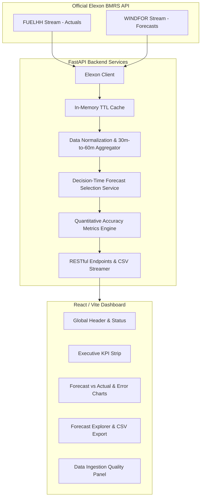

# WindScope UK — Wind Forecast Intelligence

> **"See the latest available wind forecast. Measure its accuracy. Make better-informed procurement decisions."**

WindScope UK is an enterprise-grade day-ahead wind forecast intelligence and procurement decision-support platform built for UK electricity utilities. It enables commercial power procurement teams to inspect the latest national wind generation forecasts available at any specified historical decision cutoff, compare forecasts with subsequently realized generation, and evaluate forecast accuracy and uncertainty quantitatively.

---

## 1. Project Overview

UK electricity procurement desks commit millions of pounds daily in the day-ahead wholesale electricity market. Their volume exposure depends heavily on expected renewable generation. Because wind generation varies rapidly with meteorological shifts:
1. **Under-forecasting wind** risks unnecessary thermal commitments or surplus balancing cash-out.
2. **Over-forecasting wind** risks shortfall exposure, triggering punitive System Buy Prices or emergency peaking dispatch.

### Core Capabilities
* **Decision-Time Forecast Reconstruction:** Resolves exactly which forecast revision was available to an analyst before the day-ahead procurement window closed (e.g. 09:00 UTC day-ahead).
* **Guaranteed Zero Future Leakage:** Strictly isolates and excludes revisions broadcast after the decision cutoff to prevent hindsight bias.
* **Quantitative Accuracy Engine:** Calculates Mean Absolute Error (MAE), Root Mean Squared Error (RMSE), Mean Bias Error (MBE), and Mean Absolute Percentage Error (MAPE) with strict zero-actual isolation.
* **Granular Time-Series & Error Analytics:** Visualizes hourly actuals versus forecasts, signed error deviations over time, error distribution histograms, and diurnal 24-hour cycle patterns.
* **Auditability & Provenance Tracking:** Complete transparency over ingested Elexon records, deduplication events, cutoff exclusions, and CSV data export.

---

## 2. Features

* **Executive KPI Strip:** Single-glance metrics for latest matched period, monthly volumetric MAE, RMSE penalty, directional bias (MBE), and MAPE.
* **Interactive Forecast vs Actual Chart:** Responsive Recharts dual-trace visualization plotting national wind generation in megawatts (MW).
* **Signed Error Deviation Chart:** Bar visualization with zero-reference axis distinguishing overforecasting (+MW, surplus) from underforecasting (−MW, deficit risk).
* **Forecast & Observation Explorer:** Searchable, sortable, paginated audit table with real-time status badges and instant CSV export.
* **Accuracy Distribution & Diurnal Profile:** Statistical histograms and 24-hour pattern analysis highlighting peak-hour error risks.
* **Data Ingestion Quality Panel:** Tracks raw records retrieved, duplicate actuals removed, and cutoff exclusions.
* **Domain Methodology & Governance:** Explicit mathematical formulations, Elexon schema documentation, and commercial disclaimers.

---

## 3. Technology Stack

* **Frontend:** React 18, TypeScript 5, Vite 8, Tailwind CSS v4, Recharts, Lucide Icons.
* **Backend:** Python 3.11+, FastAPI, Pydantic v2, Pandas, NumPy, HTTPX, Pytest.
* **Containerization & Ops:** Multi-stage Docker, Docker Compose, Uvicorn ASGI.
* **Data Source:** Elexon BMRS API (`FUELHH` actuals & `WINDFOR` forecasts).

---

## 4. Architecture



---

## 5. Repository Structure

```text
windscope-uk/
├── backend/
│   ├── app/
│   │   ├── api/
│   │   │   └── routes.py             # REST endpoints (/overview, /forecasts, /accuracy, /export.csv)
│   │   ├── services/
│   │   │   ├── elexon_client.py       # Elexon API connector with bounded retries
│   │   │   ├── data_normalization.py  # UTC normalization, deduplication, 30m->60m aggregation
│   │   │   ├── forecast_selection.py  # Decision cutoff selector (zero future leakage)
│   │   │   ├── accuracy_metrics.py    # MAE, RMSE, MBE, MAPE, diurnal engines
│   │   │   └── data_quality.py        # Provenance & ingestion audit counters
│   │   ├── schemas/
│   │   │   └── models.py              # Pydantic request & response models
│   │   ├── config.py                  # Settings loaded from environment variables
│   │   └── main.py                    # FastAPI entrypoint & frontend static server
│   ├── tests/
│   │   ├── test_accuracy_metrics.py   # Acceptance tests D-I, zero-actual MAPE isolation
│   │   ├── test_forecast_selection.py # Selection logic & cutoff enforcement tests
│   │   ├── test_data_normalization.py # Deduplication & aggregation tests
│   │   └── test_api.py                # Endpoint contracts & export validation
│   └── requirements.txt               # Backend dependencies
├── frontend/
│   ├── src/
│   │   ├── api/client.ts              # Typed HTTP fetch wrappers
│   │   ├── components/                # Modular UI components (Charts, Tables, Panels)
│   │   ├── types/index.ts             # Shared TypeScript data interfaces
│   │   ├── App.tsx                    # Main analytics dashboard shell
│   │   └── main.tsx                   # React root entrypoint
│   ├── package.json
│   ├── tsconfig.json
│   └── vite.config.ts
├── docs/
│   ├── client-presentation.md         # 7-slide executive pitch deck & presenter script
│   └── technical-walkthrough.md       # Architecture defense & review answers
├── Dockerfile                         # Lean multi-stage build container
├── docker-compose.yml                 # Single-command orchestration
├── .env.example                       # Environment configuration template
├── .gitignore
├── LICENSE                            # MIT License
└── README.md
```

---

## 6. Data Sources

WindScope UK strictly utilizes only the two official, public Elexon BMRS streaming datasets:

1. **Actual Wind Generation (`FUELHH`):**  
   Official API Docs: [Elexon FUELHH Stream](https://bmrs.elexon.co.uk/api-documentation/endpoint/datasets/FUELHH/stream)  
   * Filters: `fuelType = "WIND"`  
   * Fields: `startTime`, `publishTime`, `generation` (MW), `settlementPeriod` (1–48).  
   * Resolution: 30-minute settlement periods. Two consecutive half-hourly periods are averaged into an hourly equivalent actual.
2. **Forecasted Wind Generation (`WINDFOR`):**  
   Official API Docs: [Elexon WINDFOR Stream](https://bmrs.elexon.co.uk/api-documentation/endpoint/datasets/WINDFOR/stream)  
   * Fields: `startTime` (target generation hour), `publishTime` (forecast broadcast timestamp), `generation` (forecasted MW).  
   * Resolution: Hourly (60-minute blocks). Broadcast ~8 times daily. Revisions preserved via `publishDateTimeFrom/To`.

---

## 7. Forecast Methodology & Anti-Leakage Guarantee

For any target generation hour $T$ and day-ahead procurement decision cutoff $D$ (default 09:00 UTC day-ahead):
$$\text{selected\_forecast}(T, D) = \arg\max_{p_i \le D} (\text{WINDFOR revisions for } T)$$

* **Zero Future Leakage:** Any forecast revision published after timestamp $D$ is strictly quarantined and excluded.
* **Missing Data Transparency:** If no forecast was published prior to $D$, the observation is explicitly marked as unavailable. Missing values are never filled with zero.

---

## 8. Metric Formulations

* **Signed Error:** $\text{error} = \text{forecast} - \text{actual}$ (MW). Positive = overforecasting; negative = underforecasting.
* **Mean Absolute Error (MAE):** $\text{MAE} = \frac{1}{N} \sum |\text{forecast}_i - \text{actual}_i|$ (MW).
* **Root Mean Squared Error (RMSE):** $\text{RMSE} = \sqrt{\frac{1}{N} \sum (\text{forecast}_i - \text{actual}_i)^2}$ (MW).
* **Mean Bias Error (MBE):** $\text{MBE} = \frac{1}{N} \sum (\text{forecast}_i - \text{actual}_i)$ (MW).
* **Mean Absolute Percentage Error (MAPE):**  
  $\text{MAPE} = \frac{1}{N_{\text{nonzero}}} \sum_{\text{actual} > 0} \frac{|\text{forecast}_i - \text{actual}_i|}{\text{actual}_i} \times 100\%$  
  *Zero-Actual Governance:* Observations where $\text{actual} = 0$ are isolated and excluded from the MAPE denominator to prevent division-by-zero distortion, and reported transparently.

---

## 9. Prerequisites

* **Docker & Docker Compose** (recommended for production run), OR
* **Python 3.11+** and **Node.js 18+** (for manual local execution).

---

## 10. Local Setup & Execution

### Option A: Docker Compose (Recommended)

```bash
# Clone the repository
git clone <repository-url>
cd windscope-uk

# Build and launch with a single command
docker compose up --build
```
* Access the web dashboard at: **http://localhost:8000**
* Access the interactive API docs at: **http://localhost:8000/api/docs**
* Access the health check at: **http://localhost:8000/api/health**

### Option B: Local Development Setup

#### 1. Backend Setup
```bash
cd backend
pip install -r requirements.txt
python -m uvicorn app.main:app --host 0.0.0.0 --port 8000 --reload
```

#### 2. Frontend Setup
```bash
cd frontend
npm install
npm run dev
```
* Access frontend at: **http://localhost:5173** (automatically proxies `/api` requests to backend at port 8000).

---

## 11. Environment Variables

Copy `.env.example` to `.env` if custom configurations are needed:

| Variable | Default | Description |
| :--- | :--- | :--- |
| `ELEXON_BASE_URL` | `https://data.elexon.co.uk/bmrs/api/v1` | Official Elexon API endpoint |
| `EVALUATION_START` | `2026-01-01` | Default evaluation period start |
| `EVALUATION_END` | `2026-01-31` | Default evaluation period end |
| `DEFAULT_DECISION_HOUR_UTC` | `9` | Day-ahead decision cutoff hour (UTC) |
| `CACHE_TTL_SECONDS` | `900` | In-memory API response cache TTL (15 mins) |
| `PORT` | `8000` | Application port |

---

## 12. Automated Testing

Run the full automated pytest suite:
```bash
python -m pytest backend/tests -v
```

### Verified Test Results:
* **All 40 automated tests passed** in 3.38 seconds.
* Tests verify:
  * Critical acceptance criteria D, E, F, G, H, I (MAE=10, RMSE=10, MBE=0, MAPE=10% on test vectors).
  * Anti-leakage cutoff enforcement.
  * 30-minute settlement aggregation into hourly blocks.
  * Zero-actual MAPE isolation.
  * API route schemas and CSV streaming format.

Run frontend build check:
```bash
cd frontend && npm run build
```
* **Verified Result:** Clean production build with zero TypeScript or packaging errors.

---

## 13. Deployment

WindScope UK is designed for deployment as a single consolidated container or split microservices:
* **Production Docker Container:** Uses a multi-stage Dockerfile that compiles the React SPA and packages it into the Python runtime image, served directly on port 8000.
* **Cloud Targets:** Tested and compatible with Docker-based cloud hosts (AWS ECS, Google Cloud Run, Heroku Container, Render, or Railway).
* **Local Run Verification:** Validated locally on `http://localhost:8000` with full health endpoint verification (`/api/health`).

---

## 14. AI Tool Usage

*In compliance with assignment disclosure guidelines:*
* **AI Coding Assistant:** Claude Opus 4.6 and Gemini 3.8 Flash via Google Antigravity.
* **Scope of Assistance:**
  * Elexon API endpoint verification and schema probing.
  * Initial architectural scaffolding and TypeScript/FastAPI type declarations.
  * Test case formulation for mathematical acceptance criteria.
  * Documentation drafting and slide deck preparation.
* **Human Verification & Review:** All architectural decisions, mathematical formulas, timestamp parsing rules, Docker configurations, and code files were directly inspected, verified, and validated through real automated test executions and production builds.

---

## 15. Known Limitations & Governance Boundaries

1. **Resolution Alignment:** WINDFOR is published hourly whereas FUELHH is published half-hourly. Aggregating two settlement periods into an hourly average smooths intra-hour ramp extremes.
2. **Commercial Boundary:** Forecast errors do not equal the utility's financial cash-out exposure. Financial imbalance depends on system-wide buy/sell prices, bilateral contract schedules, and portfolio diversity.
3. **Historical Publication History:** Elexon preserves forecast revisions when querying by `publishDateTimeFrom/To`. If querying purely by target time `from/to`, only the latest revision is returned. The system enforces `publishDateTime` queries to maintain historical fidelity.
